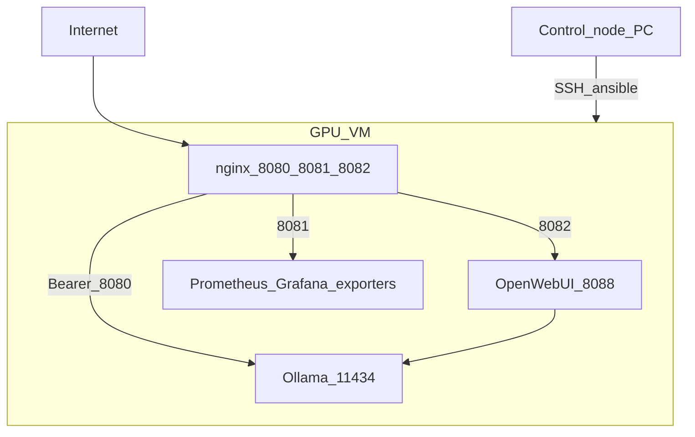

# Отчёт по тестовому заданию: GPU LLM + Ansible

Скриншоты: папка [`screenshots/`](screenshots/). Встроенные ниже картинки подгружаются с GitHub (`raw.githubusercontent.com`); после `git push` обновите страницу отчёта.

Автоматизированное развёртывание на GPU-ВМ (Ubuntu, NVIDIA): **Ollama** с моделью **qwen2.5:7b**, защищённый **API**, **Open WebUI**, мониторинг **Prometheus/Grafana**.

Площадка: [immers.cloud](https://immers.cloud) (Ubuntu 22.04, RTX 4090). Управление: Ansible с локального ПК по SSH.

---

## Результат

| Компонент | Реализация |
|-----------|------------|
| ОС и GPU | Ubuntu 22.04, драйвер NVIDIA (`nvidia-smi`) |
| Контейнеры | Docker CE + NVIDIA Container Toolkit |
| LLM | Ollama в Docker, модель **qwen2.5:7b** |
| Автозапуск | systemd `ollama-compose.service` |
| Healthcheck | `ansible-playbook ... --tags verify` |
| API | `http://127.0.0.1:11434` на ВМ; снаружи **:8080** + Bearer (Vault) |
| Веб-чат (доп.) | Open WebUI, снаружи **:8082** |
| Мониторинг (доп.) | Prometheus, Grafana **:8081**, DCGM, node/cAdvisor/nginx, ollama-exporter |

Точка входа playbook: [`playbooks/stage1.yml`](../playbooks/stage1.yml).

---

## Соответствие тестовому заданию

| Требование | Реализация | Как проверить | Скрин |
|------------|------------|---------------|-------|
| Ubuntu + NVIDIA | роль `nvidia` | `nvidia-smi` | [02](screenshots/02-nvidia-smi.png) |
| Docker + окружение | роль `docker` | `docker ps`, GPU в контейнере | — |
| Ollama / аналог LLM | роль `ollama` | `/api/tags`, модель в JSON | [03](screenshots/03-api-tags.png) |
| Автозапуск | `ollama-compose.service` | `systemctl is-enabled ollama-compose` | — |
| Проверка работоспособности | тег `verify` | PLAY RECAP `failed=0` | [01](screenshots/01-verify-recap.png) |
| README + пример API | README, этот отчёт | curl / DevHeader на :8080 | [03](screenshots/03-api-tags.png) |
| Защита API (доп.) | nginx :8080 + Bearer | без токена → 401 | — |
| Мониторинг GPU/сервера (доп.) | Grafana, DCGM, exporters | дашборды GPU / Infrastructure / LLM | [04](screenshots/04-grafana-gpu.png), [05](screenshots/05-grafana-ollama.png) |
| Графический интерфейс (доп.) | Open WebUI :8082 | чат с моделью | [06](screenshots/06-open-webui-chat.png) |

---

## Архитектура



Слои API, чата и мониторинга разделены портами и механизмами аутентификации. Подробнее (опционально): [architecture-improvements.md](architecture-improvements.md).

---

## Автоматизация (роли)

| Роль | Назначение |
|------|------------|
| `common` | пакеты, UFW (22, 8080–8082) |
| `nvidia` | драйвер NVIDIA |
| `docker` | Docker + GPU в контейнерах |
| `ollama` | Ollama, pull моделей, systemd |
| `open_webui` | веб-чат к Ollama |
| `reverse_proxy` | nginx :8080 / :8081 / :8082 |
| `monitoring` | Prometheus, Grafana, экспортеры |

---

## Развёртывание

**Предварительно:** `inventory/hosts.yml`, ключ в `certs/`, Vault — [vault-setup.md](vault-setup.md).

```bash
cd ~/ansible-gpu-llm-inference
ansible-galaxy collection install -r requirements.yml
ansible gpu_llm -m ping

ansible-playbook playbooks/stage1.yml --vault-password-file .vault_pass
```

Переменные: [`inventory/group_vars/gpu_llm/vars.yml`](../inventory/group_vars/gpu_llm/vars.yml)  
Секреты: зашифрованный `vault.yml` (токен API, пароли Grafana).

---

## Проверка тестового задания (чеклист для проверяющего)

### 1. Автоматизация и healthcheck

```bash
ansible-playbook playbooks/stage1.yml --tags verify --vault-password-file .vault_pass
```

**Ожидание:** в PLAY RECAP `failed=0`.


### 2. NVIDIA и Docker (SSH на ВМ)

```bash
nvidia-smi
docker ps
```

**Ожидание:** видна GPU; контейнеры `ollama`, мониторинг, `open-webui` в состоянии Up.


### 3. API Ollama снаружи

Токен: `vault_reverse_proxy_api_token` из Vault — см. [access-credentials.md](access-credentials.md).

```bash
curl -s "http://YOUR_VM_IP:8080/api/tags" \
  -H "Authorization: Bearer YOUR_TOKEN"
```

**Ожидание:** JSON со списком моделей, есть `qwen2.5:7b`.

Пример chat (опционально):

```bash
curl -s "http://YOUR_VM_IP:8080/api/chat" \
  -H "Authorization: Bearer YOUR_TOKEN" \
  -H "Content-Type: application/json" \
  -d '{"model":"qwen2.5:7b","messages":[{"role":"user","content":"Привет"}],"stream":false}'
```


### 4. Автозапуск

```bash
systemctl is-enabled ollama-compose
```

**Ожидание:** `enabled`.

### 5. Мониторинг Grafana (доп.)

1. Откройте `http://YOUR_VM_IP:8081` → basic auth `monitor` → вход Grafana `admin`.
2. Проверьте дашборды:

| Папка | Дашборд |
|-------|---------|
| GPU | GPU DCGM |
| Infrastructure | Linux Host, Docker Containers, nginx |
| LLM | Ollama LLM Inference |

**Ожидание:** GPU DCGM показывает загрузку; **Ollama LLM Inference** — `ollama_up` = UP; после хотя бы одного запроса к модели — `Models loaded` ≥ 1.

Справочник: [monitoring.md](monitoring.md).


### 6. Open WebUI (доп.)

1. `http://YOUR_VM_IP:8082`
2. Вход / регистрация в приложении.
3. Модель **qwen2.5:7b**, тестовое сообщение.

См. [open-webui.md](open-webui.md).


### 7. Безопасность API (доп.)

- `curl http://YOUR_VM_IP:8080/api/tags` **без** Bearer → **401**.
- Порт **11434** не открыт в UFW для интернета (доступ к Ollama только через nginx :8080 или SSH).

---

## Безопасность и секреты

- Секреты в **Ansible Vault**; не коммитить `.vault_pass`, `.pem`, `inventory/hosts.yml`.
- В репозитории — плейсхолдер `YOUR_VM_IP`, примеры без реальных токенов.

---

## Приложения

| Документ | Назначение |
|----------|------------|
| [screenshots/README.md](screenshots/README.md) | Список файлов скриншотов |
| [access-credentials.md](access-credentials.md) | Логины по портам |
| [vault-setup.md](vault-setup.md) | Настройка Vault |
| [open-webui.md](open-webui.md) | Веб-чат |
| [monitoring.md](monitoring.md) | Экспортеры и дашборды |
| [budget-run.md](budget-run.md) | Экономия на платной ВМ (админ) |
